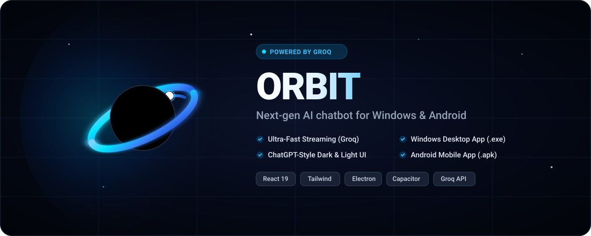

<p align="center">
  
</p>

<p align="center">
  <strong>A fast, clean AI chat app for Windows and Android, powered by Groq.</strong>
</p>

<p align="center">
  <a href="https://github.com/Yashu2004-25/orbit-ai/releases/latest/download/Orbit-Setup.exe">
    
  </a>
  <a href="https://github.com/Yashu2004-25/orbit-ai/releases/latest/download/Orbit.apk">
    
  </a>
</p>

<p align="center">
  
  
  
  
</p>

---

## 📥 Direct Downloads

| Platform | File | Direct Link |
| :--- | :--- | :--- |
| **Windows Desktop** | `Orbit-Setup.exe` | [**Download Installer (.exe)**](https://github.com/Yashu2004-25/orbit-ai/releases/latest/download/Orbit-Setup.exe) |
| **Android Mobile** | `Orbit.apk` | [**Download APK (.apk)**](https://github.com/Yashu2004-25/orbit-ai/releases/latest/download/Orbit.apk) |

> 📌 *All versions, changelogs, and releases: see the [GitHub Releases](https://github.com/Yashu2004-25/orbit-ai/releases) page.*

---

## 🚀 Installation Guide

### Windows Installation
1. Download **[`Orbit-Setup.exe`](https://github.com/Yashu2004-25/orbit-ai/releases/latest/download/Orbit-Setup.exe)** from the link above.
2. Double-click the installer to launch the setup.
3. *Note on Windows SmartScreen:* Because open-source community applications do not carry thousand-dollar commercial code-signing certificates, Windows SmartScreen may show an alert saying *"Windows protected your PC"*.
   - Click **More info**
   - Click **Run anyway**
4. Orbit installs in seconds and places a desktop shortcut for quick access.

### Android Installation
1. Download **[`Orbit.apk`](https://github.com/Yashu2004-25/orbit-ai/releases/latest/download/Orbit.apk)** directly onto your phone.
2. Tap the downloaded `.apk` in your notifications or File Manager.
3. If prompted by Android security, toggle **Allow from this source** under *Install unknown apps*.
4. Tap **Install** and open Orbit.

---

## 🔑 First-Time Setup (3 Simple Steps)

1. **Get your free Groq API key**:
   Head to [console.groq.com/keys](https://console.groq.com/keys) and generate your free API key in seconds.
2. **Open Orbit**:
   On your first launch, the Settings window will automatically appear with a welcome prompt.
3. **Save and Start Chatting**:
   Paste your key (`gsk_...`), click **Test key** to confirm connectivity, click **Save**, and start enjoying instantaneous AI responses!

---

## ✨ Features

- **ChatGPT-Inspired Aesthetics**: Clean, calm, modern interface with spacious layouts, smooth 180ms transitions, and zero visual clutter.
- **Dark & Light Mode**: Seamlessly follows your operating system theme by default, with instant manual toggles in Settings.
- **Live Response Streaming**: Fast token streaming directly from Groq's LPUs with a gentle three-dot "thinking" animation and an instant **Stop** button.
- **Flawless Markdown & Code Highlighting**: Never reveals raw markdown symbols. Full support for tables, lists, quotes, and dark code blocks with syntax highlighting and a 1-click **Copy code** button.
- **Smart Model Selector (Only Active Models)**: Dynamically fetches chat models from Groq while filtering out decommissioned/retired models. Comes with safe fallbacks:
  - `openai/gpt-oss-120b` *(Smartest)*
  - `openai/gpt-oss-20b` *(Fastest)*
- **Persistent Chat History**: Stores all your chats locally on your device with auto-titling from your first prompt, inline renaming, and safe deletion.
- **Smart Scrolling**: Automatically scrolls during streaming, but detects when you scroll up manually and displays a floating "scroll to bottom" button.

---

## 🔒 Privacy & Security

- **Local Storage Only**: Your API key and conversation history are stored **only on your device** in `localStorage`.
- **Zero Intermediary Servers**: All requests go straight from your device to the official Groq API (`api.groq.com`).
- **No Telemetry**: No trackers, no telemetry, and no data mining.

---

## 🛠️ For Developers

### Tech Stack
- **Framework**: React 19 + Vite
- **Styling**: Tailwind CSS v4 + Tailwind Typography
- **Desktop Runtime**: Electron 34 + electron-builder
- **Mobile Runtime**: Capacitor 7 (Android)
- **AI Backend**: Plain `fetch` streaming to Groq API

### Local Development Setup

```bash
# 1. Clone repository
git clone https://github.com/Yashu2004-25/orbit-ai.git
cd orbit-ai

# 2. Install dependencies
npm install

# 3. Start local web server
npm run dev
```

### Desktop & Mobile Builds

```bash
# Run desktop app locally
npm run electron

# Build Windows installer (release/Orbit-Setup.exe)
npm run dist:win

# Build Android production APK
npm run build
npx cap sync
npx cap open android
# Inside Android Studio: Build > Build Bundle(s) / APK(s) > Build APK(s)
```

---

## 📄 License

Distributed under the **MIT License**. Free for personal and commercial use.
